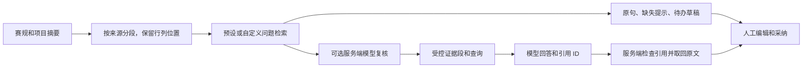

# 投递复核证据引擎开发记录

## 收到的提示词

> 你负责 EntryFlow RAG 投递复核后端与检索核心。仅改 entryflow 的 src/retrieval.js 或其他你新增的纯检索模块、server/index.js、你的测试和 docs/dev/agent-rag-engine.md。用户要求有架构和实际用途。做成实际可操作的三种预设复核（截止与资格、仓库与 Prompt/演进证据、待补交付物），以及自定义问题。设计本地无需模型的证据复核（返回可定位的规则条款、摘要里的明确线索或缺失提示、可编辑待办建议；谨慎避免无依据自动判定或把项目证据当官方规则），并增强已有真实可选 LLM 生成路径（同样检索→只发送上游受控上下文→输出带合法引用的建议；静态断网/无模型时功能可用）。结合可实现的分段和中文词/词组混合检索、规则与项目证据分来源、输出绑定原文；不要为了架构复杂而堆无用依赖。尽快与 workflow agent 对齐 JS 与 API 精确合同（最好向下兼容既有 /api/ai/review）。请添加真实 mock 或可验证集成测试，保留输入/响应边界和密钥服务端。在 docs/dev/agent-rag-engine.md 原样记录你收到的本次提示和后续反馈但绝不记录任何本机路径或人名，记录故障/修复及验证。无需写用户原始 Prompt。不要 push、不要改 git。尽快给出合同与可演示路径。

## 协作反馈

> 请尽快发本地/远程投递复核合同、预设 IDs / 来源结构 / 合同文件。计划在核验主区新增复核卡，按预设和自定义问题检索规则与摘要，建议确认后带来源加入任务。你若已有建议数据模型请给我，以便尽快接线。

回复并约定 `runLocalReview({ruleText, projectSummary, preset, query})` 同步返回查询、赛规片段、摘要片段、缺失提示和建议。片段包含 `id`、`source`、`line`、`column`、`text`、`score`。建议包含 `id`、`title`、`description`、`ruleRefs`、`projectRefs`。四种场景使用 `deadline-eligibility`、`repo-process`、`deliverables`、`custom`。

> 根验收当前样例验证各预设 3/4/6 建议、自定义演示时长第11行优先、停车场无建议。用户强调落地，我建议将 repo-process 与交付物的建议内容再落实到可直接执行的动作，例如针对仓库核对公开或评审可访问权限、用评审视角打开链接；视频写清需按原文逐项检查时长/规格/协同部分，README 复现建议从干净环境复跑并记录结果。尽量复用现有 topic 配置，不添加硬编码官方数值、无需扩大代码，继续用候选口吻。若语义已达成只需给我实际输出供验收。请把这轮反馈和实际迭代记录在模块日志。

## 证据流

浏览器和服务端共用 `src/retrieval.js`。先按原始行和标点切分，长行按重叠窗口切分，保留每段首字符的行列坐标。搜索时以中文分词为主，结合原词组、少量同义词、双字组和逆文档频率。结构化预设再用独立的赛规模式和摘要线索模式限定结果；交付物预设复用赛规材料抽取器。建议引用的赛规和摘要段分别绑定到各自的原文。检索无结果时显示待核对项，门槛仍由用户确认。

模型请求复用本地检索，最多转发 8 条规则段、4 条摘要段和问题。每条段落最多 520 个字符。模型只需返回建议正文与引用 ID。服务端要求所有 ID 均已发送，并至少引用一个赛规片段，再从发送前的片段映射回原文。请求正文、上游响应和等待时间均有上限。密钥与上游地址在服务端配置。已有客户端可继续用不带 `preset` 的数字行号接口，其摘要上下文也经过筛选。

## 修订和验证

- 检查中文与英文术语的定位边界时发现，单纯子串匹配可能将 GitHub 当作 Git 记录。英文术语增加词边界，交付物线索要求匹配具名材料。添加回归覆盖仅有 GitHub 仓库而缺真实提交记录的项目。
- 官方样例执行本地查询后，截止与资格给出 3 条建议，仓库与开发证据给出 4 条，待补交付物给出 6 条。摘要暂无明确提交日期及 Git 历史，样例中私有仓库、部分 Prompt 对话和未完成的演示视频仍以摘要原句展示。自定义「演示视频有没有时长限制？」命中赛规第 11 行。
- 根据验收反馈复用仓库与开发证据的动作模板。仓库要求实际从评审视角打开链接并记录访问结果，README 要求在干净环境完成复现并记录耗时和结果，视频候选待办按原文核对时长、规格和协同演示。以上建议继续引用具体规则，数值从原文查阅。
- `node --test tests/retrieval.test.js tests/ai-server.test.js` 通过 8 项。专项测试检查长行分段定位、同义问题、原文与坐标回指、项目摘要单独命中时不生成赛规建议；模拟上游验证两种接口、过滤无关正文、拒绝伪造 ID、拒绝只有摘要引用及拒绝超限回复。
- `node --test` 通过当时的全部 19 项测试。模型服务使用模拟上游测试，未运行第三方在线推理。
